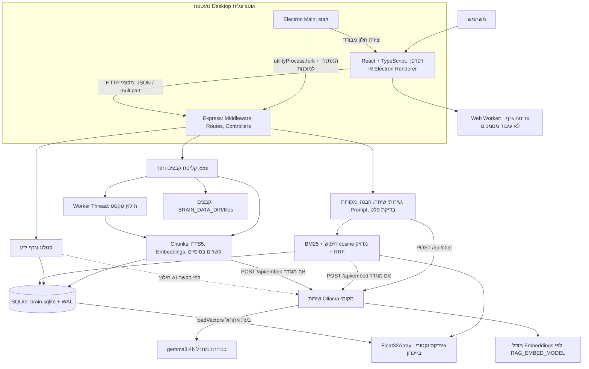
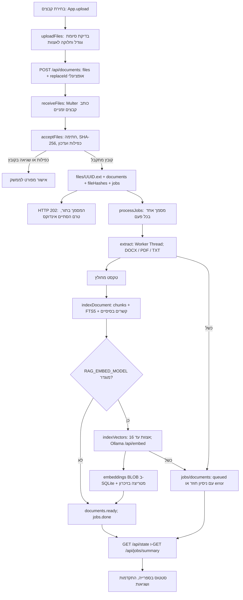
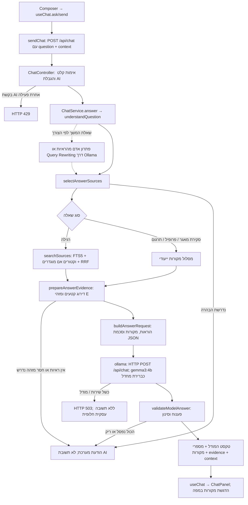
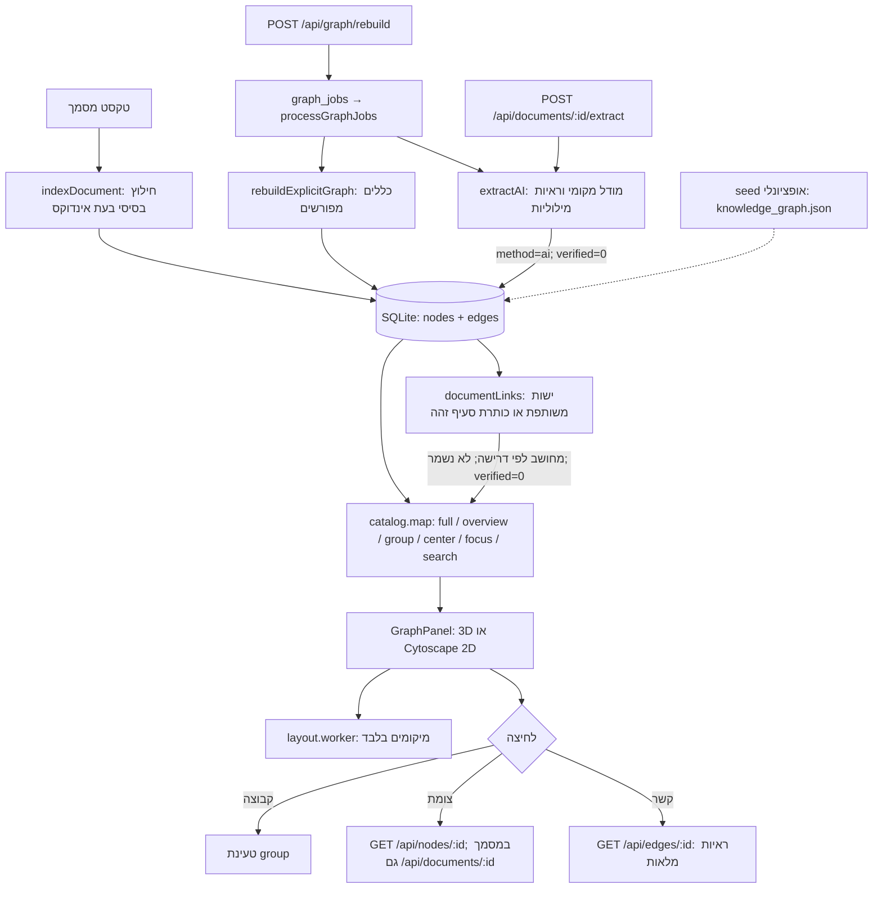

> **צילום מצב היסטורי לפני עדכון ה־AI המקומי.** לפרטי המימוש העדכני והשינויים בזרימות ראו [LOCAL-AI.md](LOCAL-AI.md).

# DemoTech Knowledge Brain — מפת ארכיטקטורה וזרימת מידע

**תאריך:** 08.11.2026. **שיטה:** בדיקה סטטית של הקוד הנוכחי. לא הופעלו שרתים, מודלים, בדיקות או תהליכי ייבוא במסגרת המיפוי. לא שונו קוד או נתונים; נוצר מסמך זה בלבד.

״ממומש״ להלן פירושו שנמצא מסלול בקוד, ולא שהרכיב הותקן או אומת בהרצה הנוכחית. ספירת מסמכים, זמינות מודלים, ביצועים ותקינות מתקין EXE לא נבדקו מחדש.

## א. ארכיטקטורה כללית

### טכנולוגיות והגדרות

- **Frontend:** React 19, TypeScript, Vite 6; דפי Brain/Library ורכיבי צ׳אט/גרף. אין כאן Angular או רכיבי Shield. גרסאות אלו מתייחסות להצהרות `package.json`.
- **Backend:** Node.js, Express 5 ו־TypeScript; `node:sqlite` הוא מסד הנתונים המובנה. `esbuild` מקמפל את השרת ל־`build/server/index.mjs`.
- **Desktop:** Electron 45.2.3 ו־electron-builder 26.18.0, יעד Windows x64/NSIS לפי `electron-builder.yml`.
- **LLM:** `OLLAMA_MODEL`, ברירת מחדל `gemma3:4b`; `OLLAMA_URL` הוא `http://127.0.0.1:11434` כברירת מחדל. הקוד מתיר רק HTTP ל־loopback ודוחה שם מודל שמכיל `cloud`.
- **Embeddings:** `RAG_EMBED_MODEL` ריק כברירת מחדל בקוד, ולכן היכולת אופציונלית. `scripts/start-organization.mjs` מגדיר `embeddinggemma:latest`. Electron יורש את משתנה הסביבה, אך אינו מגדיר מודל Embeddings בעצמו. מספר הממדים נלקח מהתשובה ונשמר במסד, ולא מקובע בקוד.
- **גרף:** `3d-force-graph`, Three.js ו־`three-spritetext` בתלת־ממד; Cytoscape ב־2D. `d3-force-3d` משמש לפריסה ב־Web Worker ומגיע כתלות עקיפה.
- **אחסון:** SQLite יחיד עם FTS5, קבצים מקומיים ומטריצת וקטורים בזיכרון התהליך. `@orama/orama` רשום כתלות, אך אינו מנוע החיפוש שבמסלול הפעיל. אין Neo4j, PostgreSQL, Redis או שירות וקטורים חיצוני במסלול שנבדק.

### מצבי הפעלה ואחסון

`server/index.ts` מפעיל `createApp → initializeRepository → configureFrontend → listen`. האתחול כולל seed אם מותר ונדרש, טעינת וקטורים קיימים, השלמת hashes והתאוששות תורים. אלה פעולות של הפעלה רגילה; הן לא הורצו לצורך מסמך זה.

- שרת רגיל: פורט ברירת מחדל `3210`; נתונים ב־`BRAIN_DATA_DIR` או `<root>/data`.
- משגר DemoTech-Organization: פורט `3213`, נתונים ב־`repositories/DemoTech-Organization`, ללא seed, עם Embeddings מוגדרים.
- Electron: פורט דינמי ב־loopback; נתונים ב־`appData/DemoTech Knowledge Brain/data`, הגדרות ב־`settings.json` ויומן ב־`logs/desktop.log`. אפשר לדרוס את שורש המשתמש באמצעות `BRAIN_DESKTOP_USER_DATA`. הנתונים אינם בתיקיית ההתקנה.
- Electron יוצר Backend כ־utility process וממתין להודעת `ready` ול־`GET /api/health`. הוא אינו מפעיל או מתקין Ollama. אין preload או API של Node שנחשף ל־Renderer; `contextIsolation=true`,‏ `nodeIntegration=false`,‏ `sandbox=true`. אסימון מקומי ו־cookie מגינים על חיבור המעטפת לשרת; זו אינה הזדהות ארגונית.

## ב. העלאת מסמך — מקצה לקצה

1. **בחירה:** `src/App.tsx::upload`, דרך הספרייה או כפתור מסמך חדש. `src/upload-queue.ts::uploadFiles` מקבל את הקבצים. הפורמטים הם DOCX, PDF ו־TXT; עד **20 MiB לקובץ**. אין תקרת מספר קבצים לבחירה. אצוות הלקוח מוגבלות ל־20 קבצים ול־50 MiB; השרת מאפשר עד 100 קבצים בבקשה. ההגדרות ב־`shared/upload-policy.ts`.
2. **בקשה:** `multipart/form-data` אל `POST /api/documents`, בשדה `files`. החלפת מסמך שולחת גם `replaceId` וקובץ יחיד. האצוות נשלחות ברצף. עצירת העלאה מונעת אצוות עתידיות ומאפשרת לבקשה הנוכחית להסתיים.
3. **שמירה:** `server/uploads.ts::receiveFiles` משתמש ב־Multer תחת `dataDir/files`. `acceptFiles` בודק חתימת PDF/ZIP בסיסית, מחשב SHA-256 בזרימה, מזהה כפילות לפי `fileHashes` ומשנה שם ל־UUID עם סיומת. נשמרים metadata ורשומת `jobs` דרך `enqueue`. התקבלות מחזירה `202` ורשימת תוצאות לכל קובץ; אין בכך אישור שהאינדוקס הסתיים. בהחלפה, הקובץ הישן נמחק אחרי קליטת ההחלפה בהצלחה.
4. **חילוץ:** `server/ingest.ts::processJobs → extract(resolveStoredPath(...))`. `server/extractor.ts::extract/getWorker` מנהל Worker Thread ותור Promise לחילוץ. `server/extract-worker.mjs` משתמש ב־Mammoth ל־DOCX, ב־pdf-parse ל־PDF וב־TextDecoder UTF-8 קשיח ל־TXT. נשמר טקסט פשוט; לא נשמר מבנה עמודים/טבלאות. מגבלות: 60 שניות לחילוץ, heap Worker של 256 MiB וטקסט עד 2,000,000 תווים.
5. **OCR:** אינו ממומש. אם אין טקסט, מתקבלת שגיאה שמציינת ש־PDF סרוק דורש OCR. במסמך מעורב אין מסלול OCR להשלמת העמודים הסרוקים.
6. **Chunks:** `indexDocument` יוצר חלונות של **1,100 תווים**, בהתקדמות של 850 — חפיפה של 250. `metadata.ts::safeSlice` מונע חיתוך זוג surrogate. זו חלוקה לפי תווים, לא לפי טוקנים או משפטים. נשמרים FTS5 `chunks` ומיפוי `chunk_documents`.
7. **Embeddings:** אם הוגדר מודל, `vectors.ts::indexVectors` שולח עד 16 קטעים לבקשה ל־`POST /api/embed`, בתבנית `title: ... | text: ...`. הווקטורים נשמרים כ־Float32 BLOB בטבלת `embeddings`, עם chunkId, documentId, model ו־dimensions. לאחר השלמת כל האצוות הם נכתבים בטרנזקציה ומוכנסים למטריצה מנורמלת בזיכרון. ללא מודל, השלב מדולג.
8. **סיום:** הזרימה הרגילה היא `queued → processing → embedding` אם נדרש, ואז `ready`; המשימה הופכת ל־`done`. מסמכים שאינם `ready` אינם מועמדים לחיפוש הרגיל.
9. **גרף:** בתוך `indexDocument` נוצר גם גרף בסיסי מפורש. חילוץ מורחב או AI אינם שלב אוטומטי בכל העלאה; ראו סעיף ד.
10. **דיווח:** `UploadProgress` מדווח על העברה ואישורי קבלה; `ProcessingPanel` ו־`LibraryPage` מדווחים על עיבוד. `App.refreshState` מבצע polling ל־state ול־jobs/summary כל 5 שניות כשהעמוד גלוי. הספרייה נטענת בעמודים של עד 100 מסמכים. אין WebSocket/SSE להתקדמות, ואין אחוז התקדמות פנימי לכל עמוד או Chunk.

**תורים:** `jobs` ו־`graph_jobs` עמידים ב־SQLite; העובדים עצמם באותו תהליך Backend. `BRAIN_PAUSE_BACKGROUND=1` עוצר את הפעלתם. `recoverPendingJobs` מחזיר עבודות שנקטעו לתור. ביטול משפיע על ממתינים; מסמך שכבר בעיבוד מושלם. קיימות עד חמש ריצות למשימה שהכשל שלה זוהה כזמני, עם השהיות מעריכיות. `scheduler.ts::interactive/interactiveIdle` נותן עדיפות לצ׳אט/חיפוש בין אצוות יצירת וקטורים; הוא אינו תור משתמשים מרכזי.

## ג. שאלת AI ו־RAG

### פונקציות וסדר העיבוד

1. `src/components/chat/Composer.tsx::Composer → src/hooks/useChat.ts::ask/send`: מציג את הודעת המשתמש ונוטל context מהודעת העוזר האחרונה. `src/services/chat.service.ts::sendChat` שולח JSON; `api.service.ts::api` קורא את התגובה או מעלה שגיאה.
2. `server/Controllers/ChatController.ts::createChatController`: שאלה באורך 2–2,000 תווים; `chat-context.ts::parseChatContext` מאמת את ההקשר. `aiExecution.busy` משותף לצ׳אט ולחילוץ AI הישיר ממסמך: בקשה נוספת נדחית ב־429, ולא נכנסת לתור. `interactive` מסמן עבודה אינטראקטיבית.
3. `Services/ChatService.ts::answer → ConversationService.ts::understandQuestion`: נרמול, משוב, תרגום, סקירת מאגר, ארגון וכינויי גוף. ארגון ברירת מחדל יכול להגיע מ־`metadata.primaryOrganization`, דרך `Repositories/ChatRepository.ts::getPrimaryOrganization`.
4. **זיכרון שיחה מוגבל:** React מחזיק messages ב־useState. לשרת מועברים השאלה הקודמת, תשובה קודמת עד 4,000 תווים, subject ודגל הבהרה, ועד ארבע ראיות של עד 2,400 תווים כל אחת. אין היסטוריית צ׳אט מלאה ב־Prompt או טבלת שיחות קבועה. רענון/ניקוי המסך מאבדים את היסטוריית הממשק.
5. **שאלת המשך:** `previousContext` בודק שהציטוטים הקודמים עדיין קיימים במסמכים מותרים ו־ready. `previousPerson` עשוי לזהות אדם יחיד שמופיע בתשובה ובראיות, בעזרת ישויות מפורשות בגרף. אחרת ייתכן Query Rewriting בקריאה נוספת ל־Ollama. החיפוש והניסוח מקבלים את השאלה העצמאית; זה אינו זיכרון בלתי מוגבל או למידה של המודל.
6. **בחירת מקורות:** `AnswerContextService.ts::selectAnswerSources` מפעיל את המסלולים הבאים:

| מסלול | מימוש ומגבלות |
|---|---|
| שאלה רגילה | `retrieval.ts::searchSources`, עד שמונה מסמכים לאחר איחוד מקורות וקיצור קטעי תוכן לכ־2,000 תווים למסמך |
| פרופיל ארגון | `answer-context.ts::organizationSources`: התאמת כותרת מדויקת, עד שלושה מקורות; היעדר פרופיל עשוי להחזיר הבהרה ללא יצירת תשובה |
| סקירת מאגר | `corpusContext`: עד 40 מסמכי ready לפי כותרת ומזהה, עם קטעים קצרים ותקציב משותף. זו אינה סריקה מלאה של כל הטקסט או של כל מאגר גדול |
| תרגום | שימוש בראיות התשובה הקודמת שאומתו מחדש |
| כספים בארגון שנקוב במפורש | מסלול מוגבל לפרופיל הארגון שנמצא; אינו מייצר תשובת כספים קבועה |

7. **אחזור:** `retrieve` מפעיל FTS5/BM25 על מילות מפתח ותחיליות, עם עד 300 תוצאות ראשוניות, סף יחסי ואיחוד לפי מסמך. אם `RAG_EMBED_MODEL` ריק — זה מסלול החיפוש היחיד. אם הוגדר: `vectorCandidates` מייצר וקטור שאלה דרך Ollama רק כשיש וקטורים טעונים; `nearest` מבצע cosine מדויק, עד 40 מועמדים וסף 0.2. `searchSources` משלב RRF בנוסחה הממומשת `1/(60+rank)`, מאגד לפי מסמך ובוחר עד שני Chunks, לעיתים עם שכן עוקב. אין ANN/HNSW או Reranker של מודל.
8. **Context:** `prepareAnswerEvidence → evidence-ranking.ts::rankEvidence` בוחר בשאלה רגילה עד 18 פסקאות בתקציב 12,000 תווים לפי התאמת מונחים; זה דירוג לקסיקלי נוסף. בסקירה נשמרים הקטעים שנאספו. לכל קטע מזהה E1, E2 וכו׳.
9. **Prompt וקריאה אמיתית:** `Prompts/ChatPrompts.ts::buildAnswerRequest` בונה system/user messages עם השאלה, הקשר מוגבל וקטעי המקור. התשובות מובנות כ־`statements`, נושאי סקירה כ־`topics`, ומשימות אדם כ־`responsibilities`. `server/ollama.ts::ollama` מבצע fetch אמיתי ל־`/api/chat` עם model, messages ו־JSON schema; `stream=false`,‏ `temperature=0`,‏ `num_ctx=8192`,‏ `num_predict=1200`, timeout של 180 שניות. שם המודל מגיע מההגדרות; זו אינה הבטחה שהמודל מותקן כעת.
10. **בדיקה והצגה:** `AnswerValidationService.ts::validateModelAnswer` מפענח JSON, מסנן מבנה, שפה, מזהי ראיה, מספרים ובדיקות חפיפת מילים. בשאלה רגילה הציטוט הוא קטע הראיה שנבחר מראש; בסקירה מצופה ציטוט שהמודל העתיק. `matchQuotedEvidence` יכול לתקן מזהה ראיה שגוי רק לפי ציטוט מילולי מזוהה. מיקום הציטוט נבדק מול טקסט המסמך ונשמר כ־startOffset/endOffset, ביחידות מחרוזת JavaScript — לא מספר עמוד PDF.

השרת מצרף `[citation]` לטקסט המודל שנותר, מחזיר רק מקורות שנעשה בהם שימוש, ויוצר conversationContext מצומצם. `useChat` מציג זאת דרך `ChatPanel`, ומעביר highlighted IDs למפה. בדיקת ציטוט מילולי/מספרים/חפיפה **אינה הוכחה שכל המשמעות העובדתית נתמכת**, במיוחד בפרפרזה או תרגום.

### הפרדה בין AI להודעות קוד

| תוצאה | האם הייתה יצירת תשובת מודל? | מה מוצג |
|---|---|---|
| `mode=ollama`,‏ `answerKind=ai` | כן | טקסט משדות המודל, לאחר סינון ועיצוב ציטוטים; תג שם המודל |
| `clarify-organization` | לא נדרשת קריאת יצירת תשובה; ייתכן שלב הבנה קודם | הודעת הבהרה קבועה, `answerKind=system` |
| `no-sources` / מזהה מפורש חסר / אין קטעים | אין קריאת יצירת תשובה; ייתכן rewrite או embed קודם | הודעת מערכת קבועה |
| `no-supported-answer` | כן, אך הפלט ריק או נפסל | הודעת מערכת קבועה; metadata של קריאת המודל עדיין יכול להופיע ב־API |
| כשל Ollama | ניסיון נכשל | שגיאה, ללא תשובה עסקית חלופית |
| `POST /api/search` | אינו מפעיל יצירת תשובה; hybrid יכול לדרוש embedding | רשימת מקורות, עם `X-Brain-Response-Kind: document-search` |

אין במסלול הנוכחי fallback שמרכיב עובדות עסקיות מחיפוש ומציג אותן כפלט AI. לעומת זאת, יש הודעות מערכת והרכבת תצוגה של טקסט המודל עם מספרי מקורות. אין לבלבל בין השניים.

## ד. גרף הידע

### יצירה, סוגים ומשמעות

- `ingest.ts::node/edge/indexDocument`: יוצר צומת document, מחלקה לפי תחילית מזהה פנימי HR/IT/FIN/SEC/OPS אם קיימת, אזכורי מסמכים לפי ID/alias, source_type כ־system, שדות בעל תפקיד מפורשים ומערכות מתוך רשימה מוכרת. סוגי קשר בסיסיים: `belongs_to`,‏ `references`,‏ `published_in`,‏ `owner`,‏ `mentions`.
- `graph-index.ts::rebuildExplicitGraph`: מופעל דרך תור בנייה מחדש, לא אוטומטית בכל העלאה. מחליף את קשרי explicit של המסמך ואינו רק מוסיף לקשרים הבסיסיים. מזהה הפניות לפי ID/כותרת מדויקת, מזהי תהליכים, כתובות דוא״ל, hosts ושדות Owner/DRI. נוספים `mentions_ticket`,‏ `mentions_email`,‏ `mentions_host`,‏ `declares_owner`. URL בטקסט מנותח לצורך hostname; לא מתבצעת גלישה אליו.
- `ingest.ts::extractAI`: שולח עד 12,000 תווים ל־Ollama ומבקש עד שמונה ישויות מסוג person/department/process/system. label חייב להופיע בראיה, והראיה חייבת להופיע במסמך. נוצר קשר `mentions`, עם `method=ai, verified=0`. אין כאן מנוע הסקת קשרים חופשי בין כל זוג ישויות.
- `seed`: עשוי לטעון גם סוגי קשר שמגיעים מ־`knowledge_graph.json`; סוגי קשר אינם enum סגור במסד. הפניה שהיעד שלה לא נמצא בטקסט אינה מסומנת כמאומתת.
- צמתים נשמרים עם id/label/type/department. קשרים עם source/target/type/documentId/evidence/method/verified. אין מסד גרפים נפרד. `verified=1` פירושו סימון ראיה מפורשת לפי הקוד; לא בדיקה אנושית שהטענה בעולם נכונה.
- `document-links.ts::documentLinks/explainDocumentLink`: יוצר `shared_entity` או `shared_topic` לפי ישות מפורשת משותפת או כותרת Markdown זהה, עם ראיה בכל מסמך. קשרים אלה הם `method=derived, verified=0, persisted=false`. ה־score הוא משקל נדירות, לא דמיון סמנטי או הסתברות. אין שימוש בווקטורי Embeddings לבניית קשרים אלה.
- צמתי `community` וקשרי `aggregate` הם תצוגות מחושבות ב־`catalog.map`, לפי sourceType/department ומניית קשרים; אינם קהילות שנלמדו במודל או עובדות עסקיות חדשות.

### טעינה ואינטראקציה

`App.loadMap → services/map.service.ts::mapUrl → GET /api/map → catalog.ts::map`. הממשק מתחיל ב־overview; API ללא overview/חיפוש/מוקד יכול להחזיר `focused-empty`. עד 250 צמתים במבט; במאגר קטן מסלול full מחזיר עד 2,000 קשרים, ובתצוגות הממוקדות קשרים שמורים מוגבלים בדרך כלל ל־600, בנוסף לנגזרים. ראיות אינן נטענות במלואן לכל המפה.

`KnowledgeGraph3D` מציג Three.js, שולח layout ל־`src/layout.worker.ts` ומנהל ציור לפי צורך. `App` מפעיל Cytoscape ל־2D; בעת כשל 3D מוצעת בחירה ב־2D. `BrainPage` נשאר מותקן כשהספרייה פתוחה, לשימור מצב המצלמה.

`App.selectNode` פותח קבוצה או בוחר ישות. effect הבחירה טוען `nodeDetails`, ובמסמך גם את הטקסט. `selectEdge` טוען את הראיה המלאה. `openSource/focusOn` פותח מסמך שהתקבל בצ׳אט וממקד את המפה אם נדרש. מצבי center/focus/search עשויים לצרף קשרים נגזרים ושכנים. השיחה אינה מבצעת GraphRAG: הגרף אינו מקור אחזור רב־שלבי ל־Prompt; השימוש ב־previousPerson הוא חריג מצומצם לפתרון כינויי גוף.

## ה. טבלת רכיבים

| רכיב | תפקיד וטכנולוגיה | קובץ / פונקציה | מתקשר עם |
|---|---|---|---|
| כניסת לקוח | React + CSS מקומי | `src/main.tsx`, `App.tsx` | מסכים, hooks, API |
| מסכים ורכיבים | שיחה, ספרייה, גרף ופרטים | `src/pages/`, `src/components/` | App ושירותי HTTP |
| שירות API | HTTP JSON / FormData | `src/services/api.service.ts::api` | Express |
| מצב שיחה | React state והקשר מצומצם | `src/hooks/useChat.ts`, `services/chat.service.ts` | ChatPanel, `/api/chat` |
| אצוות העלאה | בדיקות קבצים והתקדמות | `src/upload-queue.ts::uploadFiles` | App, `/api/documents` |
| HTTP Backend | Express 5, נתיבים ואבטחה | `server/app.ts`, `Routes/`, `Controllers/`, `Middleware/` | לקוח ושירותים |
| אתחול | seed, וקטורים והתאוששות | `Services/StartupService.ts::initializeRepository` | SQLite, קבצים ותורים |
| קליטת קבצים | Multer, hash ו־jobs | `server/uploads.ts` | קבצים, SQLite, ingest |
| חילוץ | Worker Threads, Mammoth, pdf-parse, UTF-8 | `extractor.ts`, `extract-worker.mjs` | processJobs וקבצים |
| אינדוקס ותור | Chunks, FTS וקשרים בסיסיים | `server/ingest.ts` | Worker, SQLite, vectors |
| וקטורים | Float32 BLOB, מטריצה ו־cosine | `server/vectors.ts` | SQLite, Ollama, retrieval |
| אחזור | BM25 + RRF | `server/retrieval.ts` | FTS5, vectors, ACL |
| תיאום שיחה | שלבי RAG | `Services/ChatService.ts::answer` | שירותי הבנה, מקורות, מודל ובדיקה |
| הבנת שאלה | כללים ו־rewrite לפי הצורך | `Services/ConversationService.ts` | context, metadata, גרף ו־Ollama |
| Context וראיות | בחירה ודירוג קטעים | `Services/AnswerContextService.ts`, `answer-context.ts`, `evidence-ranking.ts` | אחזור, SQLite, Prompt |
| Prompt | הוראות וסכמות JSON | `Prompts/ChatPrompts.ts::buildAnswerRequest` | ChatService ו־Ollama |
| בדיקת פלט | ציטוטים, offsets וסינון | `Services/AnswerValidationService.ts`, `claim-checks.ts` | פלט מודל ו־ChatRepository |
| גישת נתוני שיחה | SQL ו־audit | `Repositories/ChatRepository.ts` | Services ו־store |
| Ollama client | HTTP מקומי ו־health | `server/ollama.ts` | LLM ו־Embeddings בשירות חיצוני לתהליך |
| SQLite וקבצים | התמדה מקומית | `server/store.ts` | כל שירותי הנתונים |
| גרף מורחב | כללים מפורשים ותור חילוץ AI | `server/graph-index.ts` | ingest, SQLite, Ollama |
| קשרי מסמכים | קשרים נגזרים לפי דרישה | `server/document-links.ts` | SQLite וקטלוג המפה |
| תצוגת גרף | 3d-force-graph/Three.js, Cytoscape | `KnowledgeGraph3D.tsx`, `App.tsx` | GraphPanel ו־Web Worker |
| פריסת גרף | d3-force-3d ב־Web Worker | `src/layout.worker.ts` | הודעות positions בלבד ל־3D |
| Desktop | Electron Main/Renderer/utility process | `electron/main.mjs`, `electron/data.mjs` | Backend, חלון, קבצים ו־IPC |
| Build | Vite, esbuild, electron-builder | `package.json`, `scripts/build-desktop.mjs`, `electron-builder.yml` | dist, build/server, מתקין Windows |

## ו. API מרכזיים

כל הנתיבים רשומים תחת `/api` באמצעות `server/Routes/api.routes.ts`. פרמטרי מזהים נשלחים ב־URL; הממשק משתמש ב־encodeURIComponent.

| Method ונתיב | תפקיד | Controller |
|---|---|---|
| `GET /api/state` | revision ומונים | Catalog |
| `GET /api/library` | עימוד, חיפוש שם/כותרת/ID וסינון status; לא RAG | Catalog |
| `GET /api/map` | overview/group/center/ids/search/type עם limit/offset | Catalog |
| `GET /api/nodes/:id` | צומת, קשרים ופרטי מסמכים קשורים | Catalog |
| `GET /api/edges/:id` | ראיה שמורה או הסבר קשר נגזר | Catalog |
| `GET /api/documents` | רשימת מסמכים מלאה לתאימות | Documents |
| `GET /api/documents/:id` | טקסט ומצב מסמך; אינו endpoint להורדת המקור הבינארי | Documents |
| `POST /api/documents` | קליטת multipart והחלפה אופציונלית; 202 | Documents |
| `DELETE /api/documents/:id` | מחיקת קובץ ואינדקסים; 409 אם המשימה פעילה | Documents |
| `POST /api/documents/:id/extract` | חילוץ ישויות AI ישיר למסמך ready | Documents |
| `POST /api/chat` | תשובת AI או הודעת מערכת; question/context | Chat |
| `POST /api/search` | מקורות בלבד; strategy=lexical/hybrid | Search |
| `GET /api/jobs/summary` | סיכום תור, קצב משוער ומסמך נוכחי | Jobs |
| `GET /api/jobs` | עד 300 משימות אחרונות | Jobs |
| `POST /api/jobs/cancel` | ביטול ממתינים, documentIds אופציונלי | Jobs |
| `POST /api/jobs/resume` | חידוש מבוטלים; includeErrors אופציונלי | Jobs |
| `POST /api/graph/rebuild` | תור explicit/ai, documentIds אופציונלי; 202 | Graph |
| `GET /api/graph` | כל הצמתים והקשרים, לתאימות | Graph |
| `GET /api/health` | זמינות Ollama וה־LLM, מודל Embeddings המוגדר וסוג אחזור | System |
| `GET /api/metrics` | זיכרון התהליך, מוני אינדוקס/גרף וסטטיסטיקות | System |
| `GET /api/audit` | עד 100 אירועי שימוש אחרונים; לא תמלול שיחות | System |

## ז. מקומיות, תקלות ופערים

### תקשורת ועבודה ללא אינטרנט

- **לקוח–שרת:** HTTP ל־אותו origin מקומי; JSON ו־multipart. ב־development ייתכן גם HMR מקומי של Vite. ב־production אין streaming של תשובות או ערוץ WebSocket/SSE יישומי.
- **שרת–Ollama:** `/api/tags`,‏ `/api/chat`,‏ `/api/embed` ב־loopback בלבד. מעטפת Desktop משתמשת גם ב־IPC לתהליך Backend; Workers משתמשים בהודעות מקומיות.
- **שרת–אחסון:** פעולות filesystem ו־SQLite מקומיות. קבצי SQLite/WAL, קבצי מסמכים ונתוני המעטפת נשמרים בדיסק; המטריצה ו־state השיחה בזיכרון בלבד.
- **חיצוני:** לא נמצא במסלול האפליקציה endpoint אינטרנט של AI, CDN או העלאת מסמכים החוצה. כתובות מתוך מסמכים אינן נשלפות ברשת. סקריפטי ניסוי/תחזוקה אינם מסלול ריצה רגיל ולא הופעלו במיפוי.
- לאחר התקנת האפליקציה, Ollama והמודלים, החילוץ הנתמך, האינדוקס, השיחה והגרף יכולים לפעול ללא אינטרנט. הורדת dependencies/מודלים/מתקינים ועדכונים עשויה לדרוש אינטרנט אם אין עותק מקומי. לא נמצא auto-updater באפליקציה. שירותי מערכת/עדכוני Ollama והפניית תיקיית נתונים ל־OneDrive או לכונן רשת מחוץ לאחריות הקוד; מיקום מקומי אינו הוכחה שאין סנכרון חיצוני ברמת מערכת ההפעלה.

### התנהגות בכשל — המימוש הנוכחי

| מקרה | התנהגות בפועל |
|---|---|
| Ollama לא זמין | health מחזיר online=false. כשל chat/חיבור embed נעטף ב־OllamaError ומגיע ל־HTTP 503, code=OLLAMA_UNAVAILABLE. הלקוח מציג שגיאה; אין תשובה עסקית חלופית. מסלול שמסתיים בהודעת מערכת לפני קריאת המודל יכול עדיין להחזיר אותה |
| LLM אינו מותקן | health בודק שם מודל מדויק מול `/api/tags`; ה־UI מציג הודעה. chat לא מוצלח נעטף ב־503 עם הודעת התקנת מודל. אין הורדה אוטומטית |
| Embeddings לא הוגדרו | האינדוקס הווקטורי מדולג והאחזור לקסיקלי; ה־LLM יכול עדיין לנסח תשובה |
| מודל Embeddings מוגדר אך חסר/נכשל | אין מעבר אוטומטי לחיפוש לקסיקלי בעקבות שגיאת embed. HTTP לא מוצלח של `/api/embed` נזרק כ־Error רגיל ומגיע בדרך כלל ל־500 בחיפוש; כשל חיבור מגיע ל־503. באינדוקס המסמך ממתין לניסיון חוזר או נכשל לפי סיווג השגיאה. אם אין כלל וקטורים טעונים, vectorCandidates מחזיר [] לפני קריאת embed והחיפוש יכול להישאר לקסיקלי |
| מודל/ממדים לא תואמים לווקטורים הקיימים | loadVectors מכשיל את האתחול במקום להמיר או לבנות מחדש אוטומטית. גם seed התחלתי שדורש Embeddings יכול להיכשל לפני שהשרת מוכן אם שירות/מודל הדרוש לו חסר |
| אין מקורות / חסר מזהה מפורש | הודעת system, ללא יצירת עובדות. אין סף כולל שמבטיח שכל מסמך שנשלף אכן רלוונטי; רשימה לא ריקה עדיין יכולה להיות חלשה |
| פלט מודל לא תקין או לא נתמך | parse וסינון; אם לא נותרו פריטים, no-supported-answer. בדיקות אלה אינן אימות סמנטי מלא |
| העלאה נכשלת | receiveFiles מחזיר 413 לגודל או 400 לשגיאת קליטה; acceptFiles מחזיר גם שגיאות פרטניות בתוך 202. הלקוח סופר כשלים/כפילויות ומציג פרטים. כשל בקשת אצווה מסיים את סבב ההעלאה; אישורים שכבר התקבלו אינם מבוטלים |
| חילוץ/אינדוקס נכשל | jobs/documents עוברים ל־queued עם nextAttempt או ל־error. הקובץ יכול להישאר בדיסק. הזרימה כולה אינה טרנזקציה אחת: ייתכנו Chunks וקשרים שכבר נוצרו לפני כשל Embeddings, אך המסמך לא יהיה ready |
| בניית גרף בתור נכשלת | graph_jobs.status=error עם הודעה; אין באותו עובד מדיניות retry מעריכית כמו ב־jobs |

### פערים לתרשים יעד

1. **שירות ארגוני מרובה משתמשים אינו ממומש:** השרת מאזין ל־127.0.0.1, Host/Origin מוגבלים, אין OIDC/משתמשים/TLS/תור שאלות. בקשת AI נוספת נדחית. קיימים ACL primitives לחיפוש, אך `requestAccess` מחזיר undefined; יתר ה־API אינם שכבת הרשאות ארגונית מלאה.
2. **OCR ותמונות/Excel/DOC ישן אינם נתמכים.** אין שימור עמודים או מיקומי מקור חזותיים לציטוטים.
3. **אין GraphRAG פעיל או גרף קשרים סמנטיים אוטומטי.** אין להציג shared_topic כ־embedding similarity, קהילה חזותית כ־clustering נלמד, או verified כאימות אנושי.
4. **החילוץ המורחב אינו מחובר אוטומטית לכל העלאה.** הגרף הבסיסי מבוסס כללים; מחלקה לפי ID פנימי לא תמיד תחול על קובץ חדש שמקבל DOC-UUID.
5. **כיסוי סקירת מאגר מוגבל:** עד 40 מסמכים וקטעים קצרים; אין סיכום היררכי של כל קובצי מאגר גדול. אין Reranker מודלי או בודק נאמנות סמנטי מלא.
6. **זיכרון שיחה אינו התמדה:** אין מסד שיחות, סיכום היסטוריה ארוכה או הקשר מלא. המבנה שנשלח מהלקוח מאומת, אך אינו הופך את כל תוכן ההיסטוריה לעובדה מאומתת.
7. **תורים והגבלת AI אינם מנגנון אחד אחיד:** interactiveIdle מופעל באצוות Embeddings. graph_jobs יכול להפעיל extractAI בלי לעבור דרך aiExecution.busy של Controllers, ואין לו אותו retry. אין לתאר נעילה אחת שמגינה על כל קריאות המודל במערכת.
8. **פער סיווג retry:** transientError מזהה טקסטי חיבור/Timeout ו־HTTP 429/5xx. כשל חיבור embed שנעטף בהודעת OllamaError בעברית אינו בהכרח מזוהה כזמני, ולכן עלול להפוך ל־error ללא ניסיון חוזר. זו מסקנה מקריאת הקוד, לא ניסוי שבוצע כעת.
9. **health אינו בדיקת Embeddings:** הוא מחזיר את שמו המוגדר, אך מאמת התקנה של ה־LLM בלבד. אין הבטחת מוכנות מלאה של כל רכיבי RAG מ־health מוצלח.
10. **Orama והקבצים ההיסטוריים אינם תרשים הריצה:** Orama תלות לא פעילה; `rag.ts` ו־`generate-answer.ts` הם exports לתאימות. לוגיקת השיחה נמצאת ב־Services וב־Prompts. ביצועים ובדיקות עבר אינם ראיה חדשה למצב ההתקנה הנוכחי.

**הנחיה לתרשים מקצועי:** הציגו שלושה גבולות נפרדים — Renderer, תהליך Backend ושירות Ollama — ושני סוגי Worker שונים: חילוץ מסמכים בשרת ופריסת גרף בדפדפן. סמנו חצים מותנים ל־Embeddings ולחילוץ AI, והפרידו קשרים שמורים, נגזרים ואגרגציות חזותיות. רכיבים מתוכננים כגון OCR, הזדהות ארגונית ושרת מרובה משתמשים צריכים להופיע כ״לא ממומש״, ולא בתוך הזרימה הפעילה.
