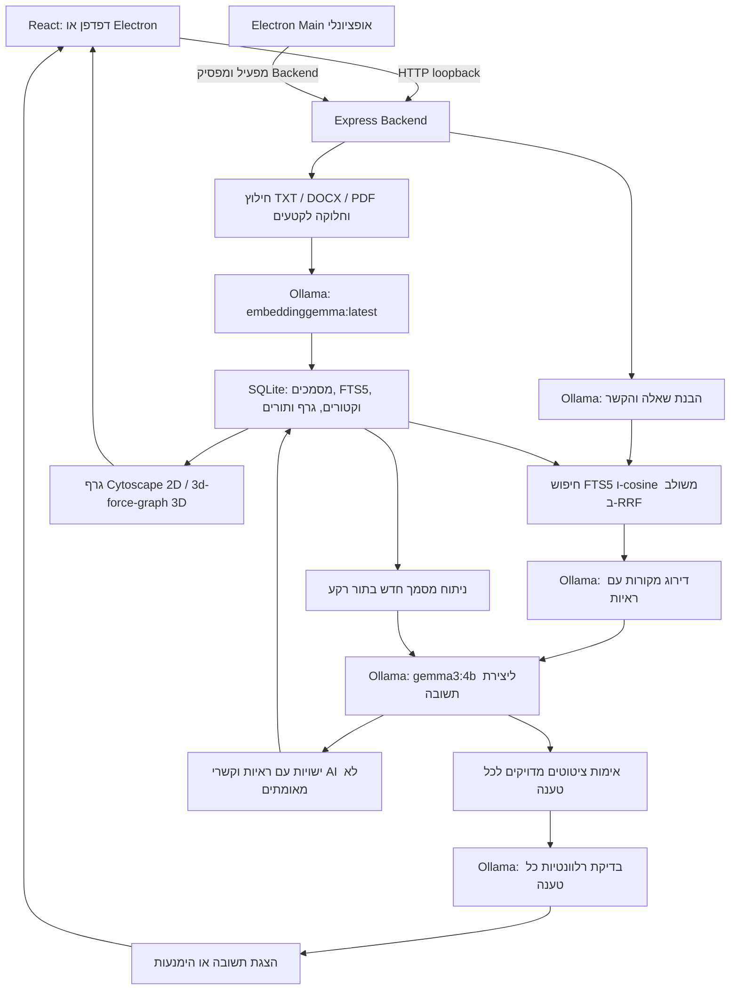

# ארכיטקטורה בקצרה

`server/index.ts` מאזין ב־127.0.0.1 בלבד. בפיתוח `FrontendMiddleware.ts` משלב Vite באותו שרת; ב־production הוא מגיש `dist/`. הלקוח פונה ל־`/api` יחסית לאותו Origin. אין משתנה כתובת Frontend ואין צורך בשרת נוסף בפורט 5173.

`store.ts` יוצר את התיקיות ואת SQLite. קבצים ב־`BRAIN_DATA_DIR/files`, נתונים ווקטורים ב־`brain.sqlite`, וקובצי WAL/SHM לידו. `vectors.ts` טוען וקטורים למטריצה בזיכרון; אין שירות Vector DB נפרד. `ingest.ts` ו־`graph-index.ts` מנהלים תורים ב־SQLite. `LocalModelQueue.ts` מסדר קריאות מודלים עם עדיפות לפעולות משתמש שממתינות.

`ConversationService.ts` מפעיל הבנת שאלה במודל. `ChatService.ts` בוחר מקורות ומפעיל יצירת תשובה; ה־Prompts ב־`server/Prompts`. `AnswerValidationService.ts` מאמת ציטוטים ובדיקות טענות בסיסיות, אך אינו מבטיח דיוק סמנטי מלא. כשל Ollama מוחזר כשגיאה במקום יצירת תשובה חלופית ללא מודל. הודעות הבהרה והימנעות הן הודעות מערכת.

במסלול חיפוש רגיל `SourceRankingService.ts` מדרג עד 16 מועמדים בקטעים מוגבלים ובוחר עד שלושה עם ראיות. הראיות מפוצלות למשפטים; ה־schema מגביל ציטוט רגיל למשפטים שנשלפו בפועל. `AnswerRelevanceService.ts` בודק כל טענה מקומית לאחר אימות הציטוט ורשאי להסיר אותה בלבד. גם בדיקת מודל זו אינה הוכחת אמת מלאה. יש בדרך כלל ארבע קריאות שפה לתשובה עובדתית; סיכום מאגר ותרגום משתמשים במסלולים אחרים. השאלה העצמאית נשמרת להודעות המשך, גם במקרה הימנעות.

ניתוח AI אוטומטי חל על מסמכים חדשים; מסמכים קיימים אינם עוברים עיבוד מחדש. הגרף כולל גם קשרים מפורשים ומבניים. לא כל קשר נוצר במודל.

`electron/main.mjs` מפעיל Backend בפורט פנוי וממתין למוכנות; סגירת החלון מפסיקה אותו. contextIsolation פעיל ו־nodeIntegration כבוי. Ollama אינו מופעל אוטומטית. אחסון Desktop ב־`%APPDATA%/DemoTech Knowledge Brain/data`, מחוץ להתקנה. אין צורך בשרת פיתוח באפליקציה בנויה.

המסלול הרגיל פונה למודלים המקומיים דרך Ollama ב־loopback. התקנה ראשונית דורשת הורדות. אימות אופליין על מחשב היעד מפורט ב־[מדריך ההתקנה](INSTALL-WINDOWS.md). פרטי AI ב־[LOCAL-AI.md](LOCAL-AI.md); `ARCHITECTURE-MAP.md` הוא צילום מצב היסטורי קודם.
