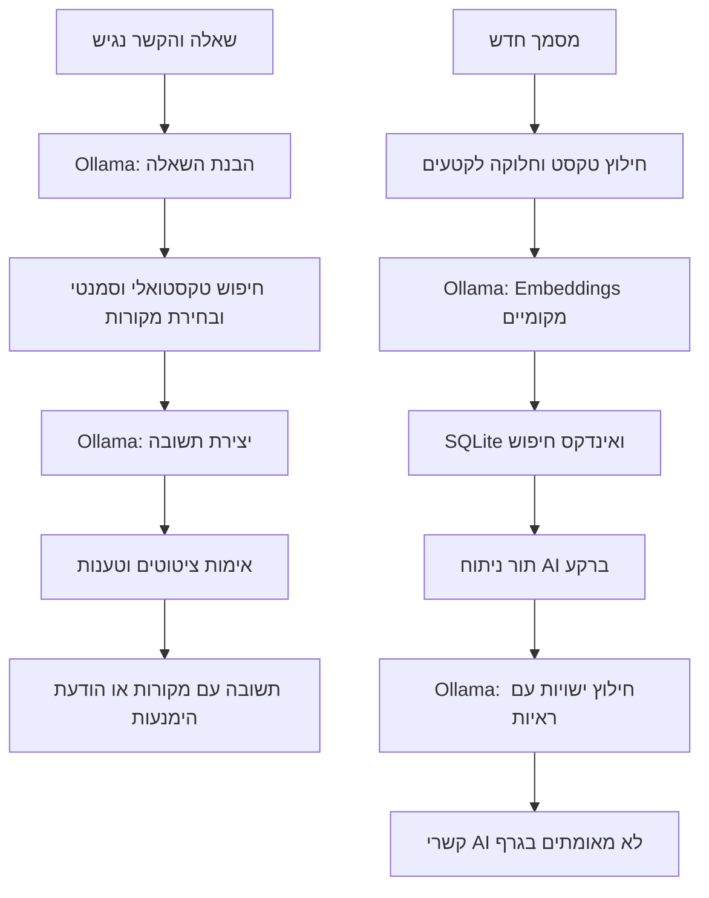

# עיבוד AI מקומי — המימוש המעודכן

מסמך זה מעדכן את מפת הארכיטקטורה הסטטית הקודמת. הגדרות וזרימות שהשתנו מתועדות כאן; מפת הארכיטקטורה הקודמת היא צילום מצב מלפני עדכון זה.

- הבנת כל שאלת צ׳אט מתבצעת ב־Ollama באמצעות `ConversationService.understandQuestion`, עם Prompt מתוך `QuestionUnderstandingPrompt.ts`. שאלות המשך משתמשות בהקשר שמקורותיו נבדקו מחדש. תוכנית חיפוש לא תקינה נכשלת במפורש, ללא החלפה במסווג כללים.
- בחיפוש רגיל נאספים עד 16 מועמדים, ולאחר מכן `SourceRankingService.ts` מפעיל דירוג מקומי עם קטעי 300 תווים ובוחר עד שלושה מקורות עם ציטוטי בחירה מדויקים. יצירת תשובה עובדתית מתבצעת בקריאה נוספת ל־`gemma3:4b`. כל טענה דורשת כעת ציטוט מדויק משלה, גם בתשובה רגילה. בדיקות הרשאות, שליפה והודעות מערכת נשארות בקוד. הימנעות אינה מוצגת כתשובת AI. קטעי הדירוג המוגבלים אינם מבטיחים אחזור מלא ממסמכים ארוכים.
- מודל ה־Embeddings המקומי המוגדר כברירת מחדל הוא `embeddinggemma:latest`. הגדרה ריקה מפורשת מיועדת לאבחון חיפוש טקסטואלי בלבד.
- מסמך חדש שעבר אינדוקס נכנס אוטומטית לתור ניתוח AI מתמשך ב־`graph_jobs`. חילוץ הישויות מכסה חלונות טקסט באורך 10,000 תווים, בחפיפה של 1,000 תווים. כל ישות חייבת להופיע בטקסט עם ראיה מדויקת. קשרי AI נשמרים כלא מאומתים.
- מסמכים קיימים אינם נשלחים אוטומטית לעיבוד מחדש. קשרים מפורשים ונתוני מבנה קיימים נשמרים לצד תוצרי AI; לא כל קשר בגרף נוצר במודל.
- `LocalModelQueue.ts` מסדר את קריאות השפה וה־Embeddings אחת אחרי השנייה, בעדיפות לפעולות משתמש שממתינות על פני עבודת רקע שממתינה. קריאה שכבר התחילה אינה נקטעת.
- הספרייה מציגה בנפרד את מצב האינדוקס ואת מצב ניתוח ה־AI, כולל שגיאות. כשל בעבודת גרף דורש ניסיון חוזר; לא נוסף מנגנון ניסיונות חוזרים אוטומטי לגרף.
- שירות המודל מוגבל לכתובת loopback מקומית. שמות מודלים המסומנים כ־cloud נדחים. בדיקת הבריאות מדווחת גם על זמינות מודל ה־Embeddings.
- כשל Ollama מוחזר כשגיאה מפורשת; אין יצירת תשובה עובדתית חלופית מקטעי חיפוש. שגיאות רשת זמניות בהעלאה מזוהות באמצעות `OllamaError.retryable`.
- משימות אישיות דורשות ציטוט מדויק הכולל את האדם הרלוונטי, ונבדקות גם סתירות מספריות בסיסיות. אימות זה אינו הוכחה סמנטית מלאה ואינו מבטיח דיוק מושלם.
- `AnswerRelevanceService.ts` בודק במודל המקומי כל טענה שכבר עברה אימות ציטוט: האם היא נתמכת בציטוט והאם היא עונה לשאלה. המסנן רשאי רק להסיר טענות, לא לייצר תשובה חלופית. גם בדיקת מודל זו אינה הוכחה סמנטית ואינה תחליף לבדיקות תשובות אמת. בשאלת חיפוש עם תשובה יש בדרך כלל ארבע קריאות: הבנה, דירוג, יצירה ובדיקה. הדבר מוסיף זמן תגובה.

בדיקות אמיתיות ותוצאותיהן נשמרות ב־`reports/local-ai` וב־`reports/rag-quality/local-ai-final*`. הבדיקות משתמשות במאגרים מבודדים; אין עיבוד מחדש של מאגר הייצור. בדיקות היחידה לבדן אינן ראיה לקריאה אמיתית למודל.
